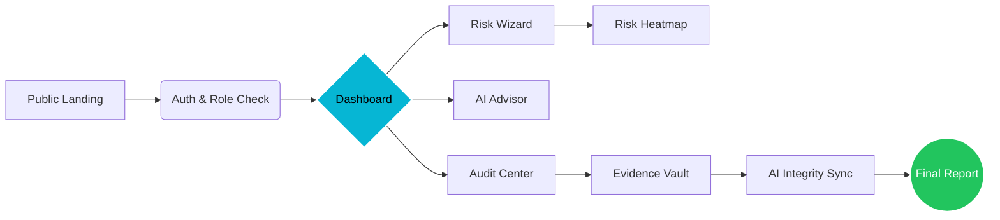

# AI-ASSISTED CYBERSECURITY RISK ASSESSMENT & SECURITY AUDIT PLATFORM

> A professional Governance, Risk, and Compliance (GRC) platform built to automate cybersecurity risk analysis and audit verification using the OCTAVE Allegro methodology, enhanced by Artificial Intelligence.

---

## 👥 Meet the Team

| NIM | Name | Email |
| :--- | :--- | :--- |
| 001202400138 | **WISNU ALFIAN NUR ASHAR** | wisnualfian117@gmail.com |
| 001202400034 | **MUHAMMAD ILHAM MAULANA** | ilham36677@gmail.com |
| 001202400079 | **CHRISTOFER SOFIAN RIALDI SITOMPUL** | refotsirhc2@gmail.com |
| 001202400081 | **MUHAMMAD AHDA BRILIANTAMA** | muhahdabriliantama01@gmail.com |
| 001202400043 | **RAFA BASIA HANIF** | rafabasia2208@gmail.com |

---

## 🎯 Project Overview

This platform is a comprehensive **Autonomous GRC (Governance, Risk, and Compliance)** solution. It automates the **OCTAVE Allegro** roadmap to help organizations transition from subjective risk guessing to **evidence-based security verification**.

### 🛠️ System Workflow

---

## 🛠️ Core Modules (The 11 Pillars)

### 1. User & Auditor Management
- **Role-Based Access Control (RBAC)**: Distinct permissions for **Administrators**, **Auditors**, and **Auditees**.
- **Secure Access**: Profile management and session monitoring to ensure system integrity.

### 2. Organization Profile
- **Asset Scope**: Definition of organizational boundaries and objectives.
- **Exposure Level**: Automated calculation of organizational risk exposure based on industry and size.

### 3. Asset Inventory
- **Critical Asset Identification**: Comprehensive database of information assets (Data, Systems, People, Containers).
- **CIA Valuations**: Assignment of **Confidentiality, Integrity, and Availability** values to each asset.
- **Criticality Scoring**: Weighted scoring system to prioritize high-value assets.

### 4. Threat & Vulnerability Identification
- **OWASP Library**: Pre-populated library of **19 critical vulnerabilities** (SQL Injection, IDOR, Broken Authentication, etc.).
- **Smart Mapping**: Logical mapping between technical vulnerabilities and business assets.

### 5. Risk Assessment Engine
- **Likelihood x Impact**: Automated calculation of risk scores across Financial, Reputational, Legal, and Operational domains.
- **Risk Matrix**: Dynamic visualization of the organization's risk landscape (Heatmap).
- **OCTAVE Allegro Lifecycle**: Guided 8-step wizard for thorough risk profiling.

### 6. Control Audit Checklist
- **Framework Compliance**: Automated checklist generation based on OCTAVE Allegro security controls.
- **Vulnerability-Triggered Controls**: Specific audit items are automatically added when certain vulnerabilities are detected.

### 7. Evidence Collection
- **Audit Verification**: Secure storage for files (PDF, JPG, PNG, DOCX) serving as proof of control implementation.
- **Direct Mapping**: Link evidence directly to specific audit checklist items for easy retrieval.

### 8. Compliance Scoring
- **Automated Calculation**: Real-time compliance percentage tracking.
- **Category Breakdown**: Visualization of compliance health across different security domains.

### 9. Audit Findings Generation
- **Automated Findings**: The system detects non-compliant controls and automatically drafts audit findings.
- **Severity Classification**: Findings are categorized from Low to Critical for immediate management attention.

### 10. AI Auditor Assistant
- **Gemini AI Integration**: Autonomous security advisor providing technical remediation steps.
- **Technical translation**: AI translates complex technical gaps into management-friendly language.
- **Mitigation Recommender**: Intelligent suggestions for risk treatment plans.

### 11. Report Generation
- **Professional Exports**: One-click generation of professional reports in **PDF, DOCX, and CSV**.
- **Executive & Technical Views**: Summarized reports for management and detailed findings for technical teams.

### 12. Secure Admin Reporting
- **Identity Verification**: Multi-factor identity check (Name, NIM, Email) against a secure authorized team database.
- **Automated PDF Generation**: Full compliance report generated directly in the browser following the official academic template.
- **Access Logging**: Every download is tracked and logged with user identity and timestamp for forensic auditing.

---

## ✨ Features Showcase

| Feature | Description | Screenshot/Status |
| :--- | :--- | :--- |
| **NASA-Style UI** | High-tech, data-dense interface inspired by mission control. | ✅ Completed |
| **Risk Heatmap** | 5x5 Matrix visualizing potential business impact vs. likelihood. | ✅ Completed |
| **AI Auditor** | Real-time security advice powered by **Google Gemini Pro**. | ✅ Integrated |
| **Instant Avatar** | Biometric profile sync with real-time UI refresh. | ✅ Optimized |
| **Audit Evidence** | Secure file upload and mapping to OCTAVE controls. | ✅ Integrated |
| **Admin Report** | Secure identity-verified PDF generation for academic submission. | ✅ Verified |

---

## 🚀 Technology Stack

| Component | Technology |
| :--- | :--- |
| **Frontend** | Next.js 14, React, Tailwind CSS |
| **UI Library** | shadcn/ui, Radix UI, Framer Motion |
| **Backend** | Supabase (PostgreSQL, Auth, Storage) |
| **AI Engine** | Google Gemini Pro |
| **Reporting** | jsPDF, AutoTable, Docx Generator |
| **Icons & Charts** | Lucide React, Recharts |

---

## 📝 Compliance & Methodology

The system is strictly aligned with the **OCTAVE Allegro** 8-step roadmap:
1. **Establish Criteria**: Qualitative impact scales.
2. **Develop Profile**: Asset identification.
3. **Identify Containers**: Technical & physical storage.
4. **Identify Threats**: Areas of concern.
5. **Identify Risks**: Scenario development.
6. **Analyze Risks**: Impact & Likelihood scoring.
7. **Select Mitigation**: Treatment plans.
8. **Verify Controls**: Audit & Evidence mapping.

> [!IMPORTANT]
> This platform is the first to integrate **Generative AI (Gemini)** to translate step 5-7 into automated technical remediation scripts.

---

## 🗺️ Technical Architecture

### System Sequence Flow

---

## 📥 Getting Started

1. **Clone & Install**: `npm install`
2. **Configure Environment**: Set up your Supabase and Gemini API keys in `.env.local`.
3. **Run Platform**: `npm run dev`
4. **Initialize Database**: Execute the SQL scripts in the `sql/` directory starting with `schema.sql`.

---

© 2026 Risk Shield System - **Team Risk Assesment Platform Project**
